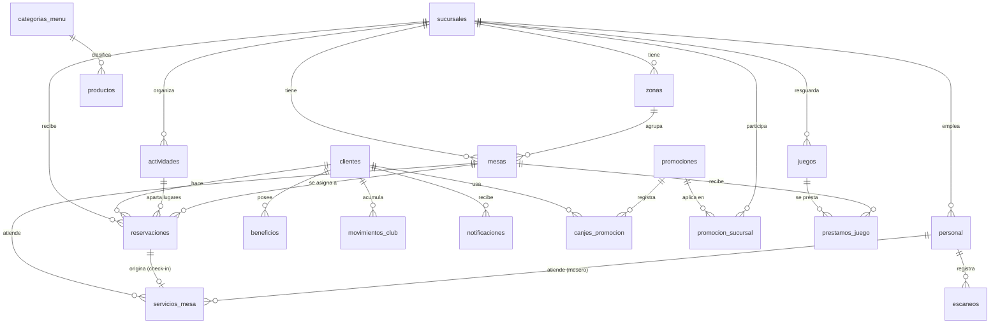

# Café Marfil — Backend (API + base de datos)

API REST que da servicio a las dos aplicaciones del monorepo:

- **Panel admin** (`frontend/admin`): reservaciones, mesas en vivo, escáner de caja, menú, promociones, ludoteca, equipo y métricas.
- **PWA de clientes** (`frontend/marfil`): menú, actividades, promociones, reservaciones, perfil, beneficios y notificaciones.

**Stack:** Node.js + Express 5 · MySQL 8 (`mysql2`) · JWT + bcrypt · validación con zod.

## Puesta en marcha

Requiere Node.js 20.19 o superior (lo mismo que piden los frontends) y un servidor **MySQL 8** encendido.

```bash
cd backend
npm install
cp .env.example .env     # en PowerShell: Copy-Item .env.example .env
#  -> edita .env con los datos de tu MySQL (DB_HOST, DB_PORT, DB_USER, DB_PASSWORD)
npm run db:seed          # crea la base cafe_marfil, sus tablas y carga los datos de ejemplo
npm run dev              # API en http://localhost:3000/api (se reinicia al guardar)
```

No hace falta crear la base a mano: si `DB_NAME` no existe, se crea sola. Luego puedes verla en phpMyAdmin o
cualquier cliente de MySQL.

Cuentas de ejemplo (todas con la contraseña `marfil2026`, solo para desarrollo):

| Dónde | Correo | Rol |
| --- | --- | --- |
| Panel admin | `admin@cafemarfil.mx` | `admin` — Sofía Valenzuela, Porras |
| Panel admin | `calvario@cafemarfil.mx` | `gerente` — Camila Rosales, Calvario |
| Panel admin | `host@cafemarfil.mx` | `host` — Valeria Siqueiros |
| Panel admin | `ludoteca@cafemarfil.mx` | `host` — Alejandro Morales |
| PWA clientes | `sofia.navarro@gmail.com` | cliente — Sofía Navarro |

### Comandos

| Comando | Qué hace |
| --- | --- |
| `npm run dev` | Levanta la API y la reinicia con cada cambio |
| `npm start` | Levanta la API sin recarga |
| `npm test` | Pruebas de integración. Usan una base aparte, `cafe_marfil_test`, en el mismo servidor MySQL: no tocan la de desarrollo |
| `npm run db:init` | Crea la base y las tablas que falten, sin tocar los datos |
| `npm run db:seed` | Carga los datos de ejemplo (solo si la base está vacía) |
| `npm run db:reset` | **Borra las tablas de `DB_NAME`**, las recrea y vuelve a cargar los datos de ejemplo. Se niega si la base contiene tablas ajenas al proyecto |

Los datos de ejemplo son relativos al momento en que se siembran: "hoy" siempre tiene mesas
ocupadas, reservaciones en curso y actividades en los próximos días. Si la demo se ve vieja,
`npm run db:reset` la refresca.

## Estructura

```text
backend/
├── src/
│   ├── server.js            # arranque (listen)
│   ├── app.js               # arma la app de Express: middlewares y rutas
│   ├── config.js            # variables de entorno y reglas del negocio
│   ├── db/
│   │   ├── schema.sql       # ← definición de la base de datos
│   │   ├── conexion.js      # pool de MySQL, transacciones y conversión de fechas
│   │   ├── semilla.js       # datos de ejemplo
│   │   └── init.js          # comandos db:init / db:seed / db:reset
│   ├── rutas/               # capa HTTP: valida la entrada, revisa permisos, responde
│   ├── servicios/           # reglas de negocio + SQL (una por módulo)
│   ├── middleware/          # autenticación y manejo de errores
│   └── utils/               # fechas, códigos, validación, errores
└── test/api.test.js         # recorre los flujos principales de punta a punta
```

Una petición recorre: `rutas/` (valida con zod y revisa el rol) → `servicios/` (aplica las reglas y
ejecuta el SQL dentro de una transacción) → respuesta JSON.

## Modelo de datos

La definición completa, con comentarios, está en [`src/db/schema.sql`](src/db/schema.sql).



| Tabla | Para qué sirve |
| --- | --- |
| `sucursales`, `zonas` | Las dos sucursales y sus áreas (Terraza, Ludoteca...) |
| `personal` | Equipo del café; quien tiene correo y contraseña entra al panel según su `rol` |
| `clientes` | Clientes del Club Marfil, con o sin cuenta en la PWA; guarda su pasaporte de sellos |
| `movimientos_club` | Bitácora de sellos y puntos (un renglón por visita) |
| `beneficios` | Monedero de premios del cliente, cada uno con código canjeable |
| `notificaciones` | Avisos que ve el cliente en la PWA |
| `categorias_menu`, `productos` | Carta: ficha del producto y su operación en cocina (disponible, stock) |
| `actividades` | Eventos y talleres, con o sin fecha fija, y su cupo |
| `mesas` | Mesas físicas y su estado (`libre` / `ocupada` / `limpieza`) |
| `reservaciones` | Reservas de mesa, juegos, actividad o evento, con folio y token de QR |
| `servicios_mesa` | Cada vez que se sienta a alguien (con reservación o walk-in), con su ticket |
| `promociones`, `promocion_sucursal`, `canjes_promocion` | Cupones, dónde aplican y cada canje realizado |
| `juegos`, `prestamos_juego` | Ludoteca y a qué mesa se prestó cada juego |
| `escaneos` | Bitácora del escáner de caja |

**Decisiones de diseño que conviene conocer**

- **Lo que se puede calcular no se guarda.** `aforoActual`, `canjesHoy`, `vecesJugadoMes`, `lugaresOcupados`,
  el estado `en_mesa` de un juego y todas las métricas del dashboard se calculan de las tablas de movimientos
  (`servicios_mesa`, `canjes_promocion`, `prestamos_juego`, `reservaciones`). Así no hay contadores que se desincronicen.
- **"Mesa reservada" es un estado derivado.** La tabla guarda solo el estado físico; la API responde `reservada`
  cuando la mesa está libre y tiene una reservación confirmada para hoy.
- **La base impide los estados imposibles.** Una mesa no puede tener dos servicios abiertos ni un juego estar prestado a
  dos mesas: `servicios_mesa` y `prestamos_juego` tienen una columna generada `abierto` (1 mientras está abierto, NULL
  al cerrarse) con un índice `UNIQUE`, que en MySQL permite muchos NULL pero un solo 1.
- **Las operaciones que compiten se bloquean por fila** (`SELECT ... FOR UPDATE` dentro de la transacción): dos hosts
  sentando gente en la misma mesa, dos cajas canjeando el último cupón del día o dos clientes apartando el último lugar
  de una actividad se atienden uno después del otro.
- **Fechas:** `DATE` y `TIME` para fechas y horas del negocio; las marcas de tiempo son `DATETIME(3)` en UTC y "hoy" se
  calcula en la zona horaria del café (`ZONA_HORARIA`). `conexion.js` convierte entre esos tipos y los textos de la API.
- **Listas simples como JSON.** `ingredientes`, `alergenos`, `incluye`, `condiciones`, `caracteristicas` son arreglos
  de texto que solo se muestran, nunca se filtran; van en una columna JSON en vez de una tabla aparte.
- `stock_diario` y `vendidos_hoy` son contadores manuales del producto: todavía no hay módulo de órdenes/POS del que derivarlos.

## Ciclos de estado

```text
Reservación:  confirmada ──check-in──▶ en_curso ──completar──▶ asistida
                  ├──cancelar──▶ cancelada
                  └──no-show───▶ no_show

Mesa:         libre ──walk-in / check-in──▶ ocupada ──liberar──▶ limpieza ──limpia──▶ libre
```

Al hacer check-in de una reservación con mesa se abre su servicio de mesa. Al completar la reservación
(o liberar la mesa) se cierra el servicio con su ticket, la mesa pasa a limpieza y los juegos prestados
a esa mesa se devuelven solos.

## API

Base: `http://localhost:3000/api`. Todo es JSON.

**Sesión:** el login devuelve un `token`; envíalo en cada petición como `Authorization: Bearer <token>`.

**Errores:** siempre `{ "error": "mensaje para mostrar", "detalles": [{ "campo", "mensaje" }] }` (`detalles` solo en errores de validación).
`400` datos inválidos · `401` sin sesión · `403` sin permiso · `404` no existe · `409` la regla de negocio no lo permite.

**Formatos:** fechas `AAAA-MM-DD`; horas en 24 h (`19:30`). Al enviar una hora también se acepta `7:30 PM`.
Las respuestas incluyen además versiones para mostrar: `fechaTexto`, `horaTexto`, `precioStr`...

Acceso: 🌐 público · 👤 cliente con sesión · 🧑‍🍳 personal · 🔑 gerencia (`admin`, `gerente`) · 👑 solo `admin`

### Sesión

| Método | Ruta | Acceso | Descripción |
| --- | --- | --- | --- |
| POST | `/auth/staff/login` | 🌐 | Login del panel → `{ token, usuario }` |
| POST | `/auth/clientes/registro` | 🌐 | Crear cuenta en la PWA → `{ token, cliente }` |
| POST | `/auth/clientes/login` | 🌐 | Login de la PWA → `{ token, cliente }` |
| GET | `/auth/me` | 👤🧑‍🍳 | A quién pertenece el token (para restaurar sesión) |

### Catálogo

| Método | Ruta | Acceso | Descripción |
| --- | --- | --- | --- |
| GET | `/sucursales`, `/sucursales/:id` | 🌐 | Sucursales con zonas, encargado y aforo actual |
| GET | `/menu/categorias` | 🌐 | Categorías de la carta |
| GET | `/menu/productos` | 🌐 | Filtros: `categoria`, `q`, `disponibles`, `destacados` |
| GET | `/menu/productos/:idOSlug` | 🌐 | Un producto |
| POST | `/menu/productos` | 🔑 | Alta de producto |
| PATCH | `/menu/productos/:id` | 🧑‍🍳 / 🔑 | Personal: `disponibleEnCocina`, `stockDiario`, `vendidosHoy`. Lo demás, gerencia |
| DELETE | `/menu/productos/:id` | 🔑 | Baja lógica |
| GET | `/actividades` | 🌐 | Vigentes. Filtros: `sucursalId`, `categoria`, `incluirPasadas` |
| GET | `/actividades/:idOSlug` | 🌐 | Una actividad con sus lugares disponibles |
| POST / PATCH | `/actividades`, `/actividades/:id` | 🔑 | Alta y edición (`activa: false` la retira) |
| GET | `/promociones`, `/promociones/:idOCodigo` | 🌐 | El público solo ve las activas; el personal ve todas |
| POST / PATCH | `/promociones`, `/promociones/:id` | 🔑 | Alta y edición (pausar = `estado: "pausado"`) |
| POST | `/promociones/:idOCodigo/canjear` | 🧑‍🍳 | Canjea un cupón. Body opcional: `sucursalId`, `codigoCliente` |

### Reservaciones

| Método | Ruta | Acceso | Descripción |
| --- | --- | --- | --- |
| POST | `/reservaciones` | 🌐👤🧑‍🍳 | Crea una reservación (invitado, cliente con sesión o host) |
| GET | `/reservaciones/publica/:tokenQR` | 🌐 | Consulta de invitado con el token secreto |
| POST | `/reservaciones/publica/:tokenQR/cancelar` | 🌐 | Cancelación de invitado |
| GET | `/reservaciones` | 🧑‍🍳 | Filtros: `sucursalId`, `fecha`, `desde`, `hasta`, `estado`, `q` |
| GET / PATCH | `/reservaciones/:folio` | 🧑‍🍳 | Consultar / editar (solo si está confirmada) |
| POST | `/reservaciones/:folio/check-in` | 🧑‍🍳 | Llegada. Body opcional: `mesaId` |
| POST | `/reservaciones/:folio/completar` | 🧑‍🍳 | Fin de la visita. Body opcional: `ticketTotal` |
| POST | `/reservaciones/:folio/cancelar`, `/no-show` | 🧑‍🍳 | Cancelar / marcar inasistencia |

Cuerpo de `POST /reservaciones`:

```jsonc
{
  "tipo": "mesa",                 // mesa | juegos | actividad | evento
  "sucursalId": "porras-matriz",
  "fecha": "2026-11-20",
  "hora": "7:30 PM",
  "personas": 4,
  "comensal": "Ana Torres",       // opcional si hay sesión de cliente
  "telefono": "618-555-0101",     // opcional si hay sesión de cliente
  "email": "ana@correo.com",      // opcional
  "notas": "Cerca de la ludoteca",
  "actividadId": "noche-cine",    // solo tipo "actividad": id o slug; fija fecha, hora y sucursal
  "mesaId": 3                     // solo lo toma en cuenta el panel
}
```

### Operación en sala (todo 🧑‍🍳)

| Método | Ruta | Descripción |
| --- | --- | --- |
| GET | `/mesas`, `/mesas/:id` | Mesas en vivo. Filtro: `sucursalId` |
| PATCH | `/mesas/:id` | `notas`, `capacidad`, `zonaId`, `forma`, `ticketTotal` (cuenta en curso) |
| POST | `/mesas/:id/walk-in` | Sienta a un comensal sin reservación: `comensal`, `personas`, `notas` |
| POST | `/mesas/:id/liberar` | Cierra el servicio (`ticketTotal` opcional) → mesa en limpieza |
| POST | `/mesas/:id/limpia` | La mesa vuelve a estar libre |
| GET | `/club/clientes`, `/club/clientes/:codigo` | Pasaportes del Club Marfil. Filtro: `q` |
| POST | `/club/clientes` | Alta de cliente en caja |
| POST | `/club/clientes/:codigo/sello` | Suma un sello por visita (+50 puntos) |
| POST | `/club/clientes/:codigo/canjear-recompensa` | Entrega el premio del pasaporte y lo reinicia |
| POST | `/club/beneficios/:codigo/canjear` | Canjea un beneficio del monedero del cliente |
| GET | `/escaner/:codigo` | Identifica un código: reservación (folio o token), cupón, pasaporte o beneficio |
| GET | `/escaner/historial` | Últimas validaciones. Filtro: `limite` |
| GET | `/juegos` | Ludoteca. Filtros: `sucursalId`, `q`, `estado` (`disponible`, `en_mesa`, `reposicion`) |
| POST / DELETE | `/juegos`, `/juegos/:id` | 🔑 Alta y baja de juegos |
| PATCH | `/juegos/:id` | Editar ficha o marcar `reposicionRequerida` |
| POST | `/juegos/:id/prestar`, `/juegos/:id/devolver` | Préstamo a una mesa (`mesaId`) y devolución |
| GET | `/personal` | Equipo. Filtros: `sucursalId`, `estado` |
| POST / PATCH | `/personal`, `/personal/:id` | 👑 Alta y edición (baja = `estado: "inactivo"`) |
| GET | `/metricas/hoy` | Indicadores del día. Filtros: `sucursalId`, `fecha` |

`GET /escaner/:codigo` solo identifica el código; la respuesta trae en `accion` el endpoint que confirma la operación.

### Mi cuenta (todo 👤)

| Método | Ruta | Descripción |
| --- | --- | --- |
| GET / PATCH | `/mi/perfil` | Datos, pasaporte de sellos y preferencias |
| GET | `/mi/reservaciones` | Reservaciones del cliente (`esHistorica` separa próximas de pasadas) |
| POST | `/mi/reservaciones/:folio/cancelar` | Cancelar una propia |
| GET | `/mi/beneficios` | Monedero; incluye la recompensa `bloqueado` con su avance de sellos |
| GET | `/mi/notificaciones` | Avisos |
| POST | `/mi/notificaciones/:id/leer`, `/mi/notificaciones/leer-todas` | Marcar como leídas |

## Cómo están conectados los frontends

El backend autoriza por CORS a `http://localhost:5173` (PWA) y `http://localhost:5174` (admin). Cada frontend lee la
URL de la API de `VITE_API_URL` (ver su `.env.example`; por defecto `http://localhost:3000/api`).

En los dos se siguió la misma idea para no rehacer la interfaz:

- `src/api/cliente.js` hace las llamadas (`fetch`), guarda el token de sesión y convierte los errores en mensajes.
- `src/api/adaptadores.js` traduce cada respuesta de la API a la forma que ya esperaban los componentes
  (la de los datos simulados). **Si cambia un campo de la API, se ajusta ahí y no en cada pantalla.**
- `App.jsx` carga los datos, y cuando un componente avisa de un cambio lo convierte en la llamada correspondiente
  y vuelve a cargar.

**Panel admin.** Inicia sesión contra la API, restaura la sesión al recargar y refresca los datos cada 30 segundos.
El plano de mesas dibuja las mesas reales de la sucursal elegida. Al hacer check-in de una reservación sin mesa, el
panel le asigna la mesa libre más chica en la que cabe el grupo.

**PWA de clientes.** El catálogo y reservar funcionan sin cuenta: el dispositivo recuerda el token de cada
reservación de invitado para consultarla o cancelarla. Perfil, beneficios y notificaciones requieren iniciar sesión
(`AuthScreen`). El carrusel del menú muestra los productos de las categorías `frappes` y `salado` que tienen
`colorCard` en su ficha.

Al conectarlos se unificó lo siguiente respecto a los datos simulados:

- **Identificadores.** Las sucursales conservan su id de texto (`porras-matriz`, `calvario`). Todo lo demás usa id numérico;
  productos y actividades traen además `slug` y la API acepta cualquiera de los dos.
- **Estados de reservación.** Son los del panel. En la PWA: `confirmada` → "Confirmada", `asistida` → "Completada", `cancelada` → "Cancelada".
- **Tipo de reservación.** `mesa`, `juegos`, `actividad`, `evento`. El `brunch` del panel es `mesa`; el rótulo libre va en `tipoNombre`.
- **Fechas y horas.** La API entrega `fecha`/`hora` en formato estándar más `fechaTexto`/`horaTexto` para mostrar.

Nombres de campo que cambian respecto a los mocks:

| En el mock | En la API |
| --- | --- |
| PWA reservación: `id`, `qrCode`, `nombreCliente`, `telefonoCliente`, `correoCliente` | `folio`, `tokenQR`, `comensal`, `telefono`, `email` |
| PWA perfil: `correo`, `nivelFidelidad`, `puntosFidelidad`, `sellosTotalesParaMeta`, `visitasRealizadas` | `email`, `nivel`, `puntos`, `sellosMeta`, `visitasTotales` |
| PWA producto: `nombreCompleto`, `nombre`, `queTrae`, `tamano`, `precioNum`, `precio` | `nombre`, `nombreCorto`, `ingredientes`, `porcion`, `precio`, `precioStr` |
| PWA actividad: `fecha`, `fechaISO`, `hora`, `precio`, `precioNum`, `descripcionCompleta` | `fechaTexto`, `fecha`, `horarioTexto`, `precioTexto`, `precio`, `descripcion` |
| PWA promoción: `nombre`, `codigoCupon`, `beneficioDetalle`, `terminos`, `sucursalesAplicables` | `titulo`, `codigo`, `beneficio`, `condiciones`, `sucursalesNombres` |
| Admin personal: `rol` (puesto), `sucursal` | `puesto`, `sucursalNombre` (`rol` ahora es el rol de acceso) |
| Admin juego: `duracionMin` | `duracion` |
| Admin sucursal: `zonas` (textos) | `zonas` (`[{ id, nombre }]`) |
| Admin escáner: tipos `reserva`, `promo` | `reservacion`, `promocion` (y se agrega `beneficio`) |

## Pendientes para siguientes versiones

- **Órdenes / punto de venta.** No hay tabla de órdenes, así que "ventas por categoría" del dashboard (la dona sigue
  con datos fijos) y `vendidosHoy` no se pueden calcular; `ventasHoy` sale del ticket que se captura al liberar cada mesa.
- **Posición de las mesas en el plano.** El plano acomoda las mesas en filas en el orden en que están registradas;
  faltaría guardar la posición de cada una.
- **Métricas por semana y mes**, que el dashboard hoy simula multiplicando las del día.
- **Reservaciones de otros días en el panel.** La tabla muestra las de hoy; no hay selector de fecha en la interfaz.
- **Pantalla de inicio de la PWA.** De `HomeScreen` solo la sección de sucursales viene de la API; el resto
  (hero, platillos destacados, textos) sigue fijo en el código.
- **Escanear beneficios.** La API ya identifica y canjea códigos de beneficio (`MF-BEN-...`), pero la pantalla del
  escáner aún no los muestra.
- Recuperación de contraseña, verificación de correo y límite de intentos de login.
